# Milestone 2: Agile Planning and DevOps Workflow

## 1. User Stories & Acceptance Criteria

### User Story 1: Attendee Registration (Story Points: 3)
> **As an** prospective conference attendee,  
> **I want to** submit my name, email, organization, ticket type, and track choice via an online form,  
> **So that** I can register for the summit and receive an official confirmation ID.

- **Scenario 1.1: Valid Registration Submission**
  - **Given** the user is on the conference registration page,
  - **When** they fill out all required fields with valid data and click "Submit Registration",
  - **Then** the system saves the participant with `PENDING` status,
  - **And** returns HTTP 201 Created with a unique `CONF-XXXXXXXX` ID,
  - **And** displays the confirmation box with the generated ID.

- **Scenario 1.2: Invalid Input Validation**
  - **Given** the user enters an invalid email format (e.g., `user@domain`),
  - **When** they click "Submit Registration",
  - **Then** the form submission is blocked,
  - **And** a clear error message indicates that a valid email address is required.

- **Scenario 1.3: Duplicate Email Prevention**
  - **Given** a participant with email `john@devops.org` is already registered,
  - **When** another submission attempts to use `john@devops.org`,
  - **Then** the server responds with HTTP 400 Bad Request,
  - **And** displays: "Email already registered: john@devops.org".

---

### User Story 2: Self-Service Status Lookup (Story Points: 2)
> **As an** attendee who has registered,  
> **I want to** search using my Registration ID or Email address,  
> **So that** I can track whether my pass has been reviewed and approved.

- **Scenario 2.1: Successful Status Lookup**
  - **Given** an attendee has registered with ID `CONF-ABC12345`,
  - **When** they enter `CONF-ABC12345` into the search box and click "Lookup Status",
  - **Then** the system displays their details along with a colored badge showing current status (`PENDING`, `APPROVED`, `REJECTED`, or `CHECKED_IN`).

---

### User Story 3: Admin Review & Status Approval (Story Points: 5)
> **As a** conference organizer,  
> **I want to** view all participant submissions in an admin dashboard and approve or reject them with a single click,  
> **So that** I can efficiently process attendee passes and maintain accurate headcounts.

- **Scenario 3.1: Pass Approval**
  - **Given** the organizer is on `/admin.html` viewing pending registrations,
  - **When** they click the "Approve" button on a participant record,
  - **Then** the system issues a `PUT /api/participants/{id}/status` request with status `APPROVED`,
  - **And** the UI immediately changes the badge to green `APPROVED` without page refresh,
  - **And** the KPI metric counters update automatically.

---

## 2. Product Backlog (Prioritized)

| Backlog ID | Story Title | Priority | Estimation (SP) | Target Sprint |
|---|---|---|---|---|
| **PBI-01** | Attendee Registration & Validation Form | High | 5 | Sprint 1 |
| **PBI-02** | Registration REST API & H2 Persistence | High | 5 | Sprint 1 |
| **PBI-03** | Self-Service Status Tracker Workflow | Medium | 3 | Sprint 1 |
| **PBI-04** | Admin Participant Listing & Filtering Dashboard | High | 5 | Sprint 1 |
| **PBI-05** | One-Click Admin Approval / Rejection API | High | 3 | Sprint 1 |
| **PBI-06** | Real-Time Metrics & CSV Roster Export | Medium | 2 | Sprint 1 |
| **PBI-07** | Automated CI/CD Jenkins Pipeline as Code | High | 5 | Sprint 1 |
| **PBI-08** | Multi-Stage Hardened Docker Packaging | High | 5 | Sprint 1 |
| **PBI-09** | End-to-End Selenium Test Suite (5 Journeys) | High | 5 | Sprint 1 |
| **PBI-10** | Ansible Idempotent Server Provisioning & Rollback | High | 5 | Sprint 1 |

---

## 3. 15-Task Kanban / Scrum Board (Sprint 1)

```
+----------------------------------------------------------------------------------------------------+
|                                    15-TASK KANBAN TASKBOARD                                        |
+---------------------+-----------------------+------------------------+-----------------------------+
|    TO DO (Backlog)  |      IN PROGRESS      |     IN CODE REVIEW     |            DONE             |
+---------------------+-----------------------+------------------------+-----------------------------+
|                     |                       |                        | TASK-01: App Scaffold       |
|                     |                       |                        | TASK-02: Participant Model  |
|                     |                       |                        | TASK-03: Registration Form  |
|                     |                       |                        | TASK-04: Client Validation  |
|                     |                       |                        | TASK-05: Server Validation  |
|                     |                       |                        | TASK-06: Pass ID Generator  |
|                     |                       |                        | TASK-07: Confirmation Modal |
|                     |                       |                        | TASK-08: Status Lookup API  |
|                     |                       |                        | TASK-09: Status Lookup UI   |
|                     |                       |                        | TASK-10: Admin Dashboard    |
|                     |                       |                        | TASK-11: Approval Actions   |
|                     |                       |                        | TASK-12: Filter & Search    |
|                     |                       |                        | TASK-13: CSV Data Export    |
|                     |                       |                        | TASK-14: Realtime Analytics |
|                     |                       |                        | TASK-15: DevOps Health API  |
+---------------------+-----------------------+------------------------+-----------------------------+
```

---

## 4. Definition of Done (DoD) Checklist

A task or user story is only marked **DONE** when the following criteria are fulfilled:
- [x] **Code Complete**: Feature implementation complies with architectural guidelines and formatting conventions.
- [x] **Unit Testing**: Unit tests written with JUnit 5 / assertions; 100% pass rate.
- [x] **Integration & UI Testing**: Verified against the 5 Critical User Journey Selenium automated test suite.
- [x] **Git Branching Policy**: Developed on dedicated `feature/*` branch, approved via Pull Request code review, cleanly merged into `develop`.
- [x] **Merge Conflicts Resolved**: Zero unresolved conflict markers in codebase.
- [x] **CI/CD Build Passing**: Jenkins pipeline compiles, packages, and tests without failure.
- [x] **Containerized**: Successfully builds via multi-stage `Dockerfile` and runs as non-root user.
- [x] **Health Check Verified**: `/api/health` returns HTTP 200 with status `UP`.
- [x] **Documentation**: Architecture, API documentation, and changelog updated.

---

## 5. End-to-End DevOps Lifecycle Diagram

```mermaid
flowchart LR
    subgraph Plan_and_Code ["1. Plan & Code"]
        Jira["Agile User Stories"] --> Branch["Feature Branch<br/>(GitFlow)"]
        Branch --> Commit["Conventional Commits"]
    end

    subgraph CI_Pipeline ["2. Continuous Integration (Jenkins)"]
        Commit --> Hook["Webhook Trigger"]
        Hook --> JBuild["Jenkins Pipeline"]
        JBuild --> Maven["Maven Build & Package"]
        Maven --> JUnit["Unit Tests (JUnit 5)"]
        JUnit --> Selenium["Selenium E2E Tests"]
        Selenium --> QualityGate{"Quality Gate:<br/>Tests Passed?"}
        QualityGate -- No --> Stop["Stop Build & Alert"]
        QualityGate -- Yes --> Archive["Archive Artifacts"]
    end

    subgraph Container_and_Delivery ["3. Continuous Delivery & Deployment"]
        Archive --> DockerBuild["Docker Multi-Stage Build"]
        DockerBuild --> Tag["Version Tagging"]
        Tag --> Registry["Docker Registry"]
        Registry --> Ansible["Ansible Playbook"]
        Ansible --> Target["Deploy to Target Node"]
        Target --> Nginx["Nginx Reverse Proxy / Tomcat"]
    end

    subgraph Monitor_and_Recover ["4. Operations & Reliability"]
        Nginx --> Health["Healthcheck (/api/health)"]
        Health -- Healthy --> Live["Production Live"]
        Health -- Unhealthy --> Rollback["Automated Rollback<br/>(Previous Stable Release)"]
    end
```



