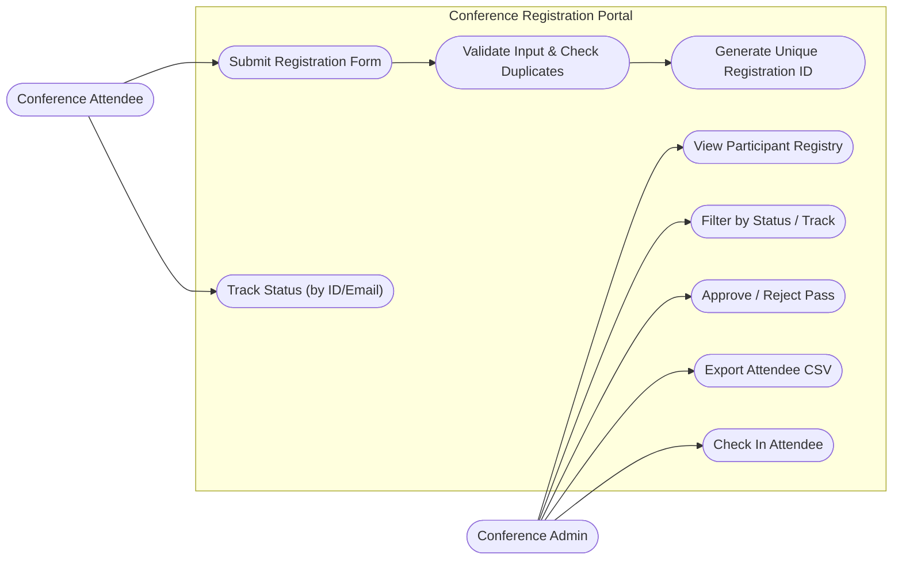
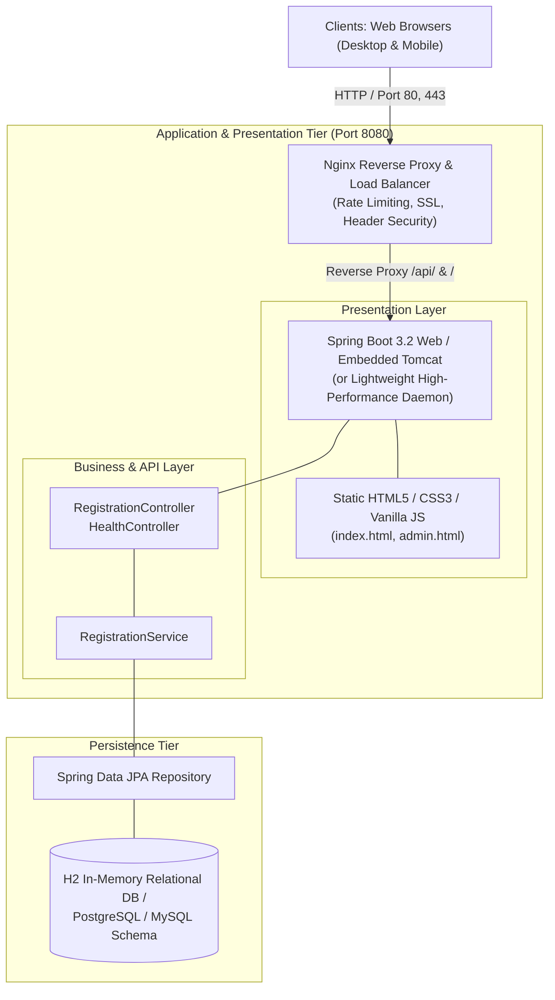
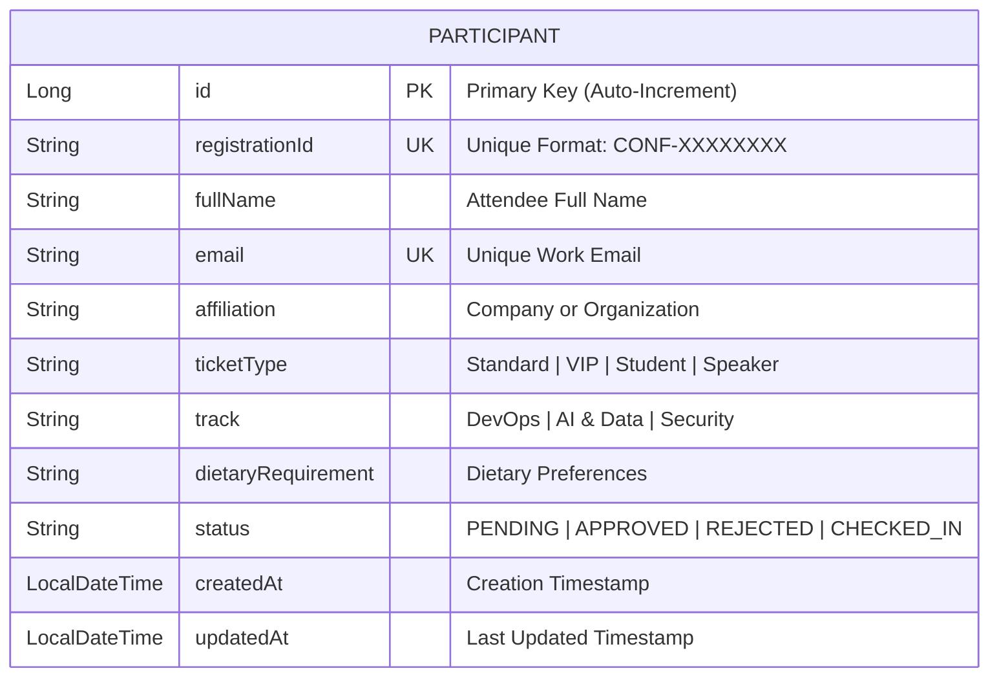

# Milestone 3: Requirements, Architecture, and Technology Setup

## 1. Software Requirements Specification (SRS) Summary

### Functional Requirements (FR)
- **FR-01 (Registration Form)**: The system shall present an online registration form capturing Full Name, Work Email, Affiliation, Ticket Category (Standard, VIP, Student, Speaker), Primary Conference Track, and Dietary Preferences.
- **FR-02 (Input Validation)**: The system shall perform client-side and server-side validation rejecting invalid emails, empty required fields, and duplicate email submissions.
- **FR-03 (Unique Pass Identifier)**: The system shall automatically generate a unique, non-duplicable Registration Identifier (`CONF-XXXXXXXX`) upon successful participant registration.
- **FR-04 (Self-Service Status Tracking)**: Attendees shall be able to query the status of their registration at any time by entering their Registration ID or registered Email address.
- **FR-05 (Admin Participant Listing)**: Event organizers shall access a dedicated administrative dashboard displaying all registrations in a sortable, filterable table.
- **FR-06 (Status Workflow Transition)**: The admin shall be able to update participant status across `PENDING`, `APPROVED`, `REJECTED`, and `CHECKED_IN`.
- **FR-07 (Data Export)**: The administrative dashboard shall provide a one-click CSV export of participant data.
- **FR-08 (System Health Probe)**: The system shall expose a `/api/health` REST endpoint returning HTTP 200 and system uptime metadata for container and load-balancer probes.

### Non-Functional Requirements (NFR)
- **NFR-01 (Performance)**: The API response time for registration submission and tracking lookups shall not exceed 300ms under standard load.
- **NFR-02 (Availability)**: The service architecture shall target 99.9% uptime with zero-downtime rolling updates.
- **NFR-03 (Security)**: All public communication shall be routed through a reverse proxy enforcing security headers (CSP, X-Frame-Options, HSTS). The runtime container shall execute under a non-root system user (`appuser`).
- **NFR-04 (Portability)**: The application shall be packaged into self-contained Docker images and run seamlessly on Linux, Windows, or cloud environments.

---

## 2. Use-Case Diagram



---

## 3. High-Level Application Architecture Diagram



---

## 4. Data Model & Entity-Relationship (ER) Diagram



---

## 5. Complete REST API Catalog

| Method | Endpoint | Request Body | Response Codes | Description |
|---|---|---|---|---|
| `GET` | `/api/health` | None | `200 OK` | Production health check and version probe |
| `GET` | `/api/stats` | None | `200 OK` | Returns aggregated registration metrics |
| `POST` | `/api/register` | JSON (`fullName`, `email`, `affiliation`, `ticketType`, `track`) | `201 Created`<br/>`400 Bad Request` | Registers attendee, checks duplicate email, returns generated ID |
| `GET` | `/api/participants` | Query params: `?status=&track=` | `200 OK` | Returns list of participants matching filters |
| `GET` | `/api/participants/{id}` | Path param: `registrationId` | `200 OK`<br/>`404 Not Found` | Retrieves single participant details |
| `PUT` | `/api/participants/{id}/status` | JSON (`{"status": "APPROVED"}`) | `200 OK`<br/>`400 Bad Request`<br/>`404 Not Found` | Updates participant status |
| `GET` | `/api/track/{query}` | Path param: `registrationId` or `email` | `200 OK`<br/>`404 Not Found` | Public self-service lookup |

---

## 6. Working Local Setup Instructions

1. **Prerequisites**:
   - Modern web browser (Chrome, Firefox, Edge)
   - Node.js 18+ or Java 17+ with Maven 3.8+
2. **Immediate Local Launch**:
   ```powershell
   # Start the portal in local development mode
   node server.js
   ```
3. **Accessing the Portal**:
   - Attendee UI: `http://localhost:8080/index.html`
   - Admin UI: `http://localhost:8080/admin.html`
   - Healthcheck: `http://localhost:8080/api/health`
