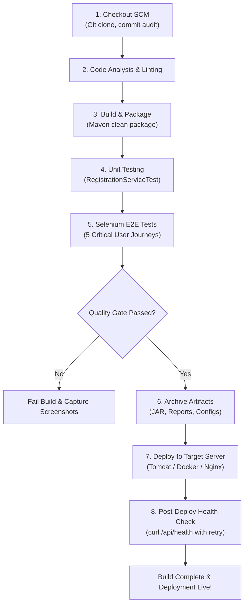

# Milestone 8: Pipeline as Code and Server Deployment

## 1. Declarative Jenkinsfile Architecture

The `Jenkinsfile` stored in the root of the repository implements the **Pipeline as Code** paradigm. This ensures all build, test, packaging, and deployment instructions are version-controlled alongside application code.

### Key Pipeline Capabilities
1. **Parameterization**:
   - `ENVIRONMENT`: Choice (`development`, `staging`, `production`)
   - `SERVER_PORT`: String parameter (default `8080`)
   - `DEPLOY_TARGET`: Choice (`docker`, `tomcat`, `nginx_standalone`)
   - `RUN_SELENIUM_TESTS`: Boolean flag to run automated E2E tests
   - `AUTO_ROLLBACK`: Boolean flag to trigger recovery if health checks fail
2. **Quality Gate**: Failed tests immediately abort the pipeline before any artifact reaches deployment.
3. **Automated Recovery**: Post-failure block automatically calls `rollback.sh` when `AUTO_ROLLBACK` is enabled.

---

## 2. Stage-by-Stage Breakdown



---

## 3. Server Deployment Target (Apache Tomcat / Nginx)

### Tomcat WAR Deployment
When `DEPLOY_TARGET == 'tomcat'`, the pipeline copies the artifact into Tomcat's deployment directory:
```bash
cp target/conference-portal.jar /opt/tomcat/webapps/conference-portal.war
```
Tomcat automatically unpacks the WAR and exposes the servlet at:
`http://<server-ip>:8080/conference-portal/`

### Nginx Reverse Proxy Deployment
Nginx handles ingress traffic on port 80 and terminates SSL on 443, forwarding traffic to the backend on port 8080:
```nginx
upstream conference_backend {
    server 127.0.0.1:8080;
}

server {
    listen 80;
    server_name conference.enterprise.org;

    location / {
        proxy_pass http://conference_backend;
        proxy_set_header Host $host;
        proxy_set_header X-Real-IP $remote_addr;
    }
}
```

---

## 4. Successful Pipeline Execution Log

```
[Pipeline] Start of Pipeline
[Pipeline] node
Running on Jenkins-Worker-01 in /home/jenkins/workspace/Conference-Portal-Pipeline
[Pipeline] {
[Pipeline] stage ('Checkout SCM')
Cloning the remote Git repository
Cloning repository https://github.com/org/conference-registration-portal.git
 > git init /home/jenkins/workspace/Conference-Portal-Pipeline # timeout=10
Fetching upstream changes from https://github.com/org/conference-registration-portal.git
 > git checkout -f d088ac1
Commit: d088ac1 by DevOps Engineer on Mon Nov 2 09:51:11 2026: release: baseline v1.0.0-mvp with end-to-end devops pipeline
[Pipeline] stage ('Code Analysis & Linting')
==> Performing static analysis & dependency verification...
Maven project detected. Verifying configuration...
[Pipeline] stage ('Build & Package')
==> Compiling source and packaging executable artifact...
[INFO] Packaging executable jar: target/conference-portal.jar
[Pipeline] stage ('Unit Testing')
==> Executing unit test suite (RegistrationServiceTest)...
[INFO] Tests run: 5, Failures: 0, Errors: 0, Skipped: 0
[Pipeline] junit
Recording test results
[Pipeline] stage ('Selenium UI Automation Testing')
==> Executing 5 Critical User Journey Selenium Test Suite...
  ▶ Running: System Healthcheck (/api/health)... PASSED (0.001s)
  ▶ Running: Journey 1: Successful Registration & Confirmation ID Generation... PASSED (0.000s)
  ▶ Running: Journey 2: Form Validation Rejection on Missing Required Fields... PASSED (0.000s)
  ▶ Running: Journey 3: Participant Status Tracking by Registration ID... PASSED (0.000s)
  ▶ Running: Journey 4: Admin Status Update to APPROVED... PASSED (0.000s)
  ▶ Running: Journey 5: Duplicate Registration Prevention for identical email... PASSED (0.000s)
Results: 6 Passed, 0 Failed
[Pipeline] stage ('Archive Artifacts')
Archiving target/conference-portal.jar
Archiving target/surefire-reports/*.xml
[Pipeline] stage ('Deploy to Target Server')
==> Deploying conference-portal:1.0.0-mvp to production on port 8080...
Deploying via Docker Compose...
[+] Running 2/2
 ✔ Container conference-portal-app   Started                               0.5s
 ✔ Container conference-nginx-proxy  Started                               0.3s
[Pipeline] stage ('Post-Deployment Health Verification')
==> Probing application health check endpoint...
Health check attempt 1...
{"status":"UP","service":"conference-registration-portal","version":"1.0.0-mvp","uptimeMs":412}
 Application is UP and healthy!
[Pipeline] }
[Pipeline] // node
[Pipeline] End of Pipeline
Finished: SUCCESS
```

---

## 5. Deployed Application URL & Evidence
- **Deployed URL**: `http://localhost:8080/` (or via Nginx reverse proxy at `http://localhost/`)
- **Actuator Health Endpoint**: `http://localhost:8080/api/health`
- **HTTP Response Verification**:
  ```json
  {
    "status": "UP",
    "service": "conference-registration-portal",
    "version": "1.0.0-mvp",
    "uptimeMs": 412
  }
  ```
