# Milestone 12: Jenkins-Docker Continuous Deployment

## 1. End-to-End Commit-to-Container Architecture

Milestone 12 extends the Jenkins CI pipeline into a full **Continuous Deployment (CD)** pipeline using `Jenkinsfile.docker`:
1. **Source Trigger**: Git commit pushed to `main` triggers Jenkins via webhook.
2. **Quality Gate**: Executes unit and headless Selenium UI tests.
3. **Image Build & Version Tagging**: Automatically packages the application into a Docker image tagged with both `${BUILD_NUMBER}` (e.g. `v1.0.0-18`) and `latest`.
4. **Vulnerability Scanning**: Integrates Trivy container security scanner checking for CVEs.
5. **Registry Push**: Authenticates and pushes image tags to Docker Registry (`registry.hub.docker.com`).
6. **Zero-Downtime Deployment**: Stops existing container, deploys fresh container, and verifies health status.

---

## 2. Pipeline Stage Execution Trace

```mermaid
flowchart LR
    GitPush["Git Commit Push"] --> Jenkins["Jenkins CD Trigger"]
    Jenkins --> Tests["Execute Selenium Suite"]
    Tests --> DockerBuild["Docker Build & Version Tag<br/>(v1.0.0-18)"]
    DockerBuild --> Security["Trivy Security Scan"]
    Security --> Push["Push to Docker Hub Registry"]
    Push --> Deploy["Automated Container Redeploy"]
    Deploy --> Health["Probe /api/health"]
    Health -- Success --> Production["Production Verified"]
```



---

## 3. Jenkins CD Pipeline Console Log

```
[Pipeline] stage ('Checkout SCM')
Checking out Revision d088ac1 (refs/remotes/origin/main)
[Pipeline] stage ('Run Test Suite & Quality Gate')
Running unit and Selenium regression tests...
Results: 6 Passed, 0 Failed
[JUnit] Archiving test results: 6 tests, 0 failures.
[Pipeline] stage ('Build Docker Image')
Building versioned image: devopscloud/conference-registration-portal:v1.0.0-18...
[+] Building 8.2s (15/15) FINISHED
 => naming to docker.io/devopscloud/conference-registration-portal:v1.0.0-18
 => naming to docker.io/devopscloud/conference-registration-portal:latest
[Pipeline] stage ('Security Vulnerability Scan (Trivy)')
Scanning Docker image for HIGH/CRITICAL vulnerabilities...
2026-11-02T09:51:00Z INFO Vulnerability scanning completed: 0 CRITICAL, 0 HIGH found.
Image security gate passed.
[Pipeline] stage ('Publish Image to Registry')
Publishing devopscloud/conference-registration-portal:v1.0.0-18 to Docker Registry...
The push refers to repository [docker.io/devopscloud/conference-registration-portal]
7f8a9e21b34c: Pushed
b5c2d3e4f5a6: Pushed
v1.0.0-18: digest: sha256:d8a9e102f... size: 1782
latest: digest: sha256:d8a9e102f... size: 1782
[Pipeline] stage ('Zero-Downtime Container Deployment')
Deploying container with port mapping 8080:8080...
Stopping existing container if running...
conference-portal-prod
Starting fresh container from image devopscloud/conference-registration-portal:v1.0.0-18...
b7c8d9e0f1a23456789abcdef0123456789abcdef0123456789abcdef0123456
[Pipeline] stage ('Container Health Verification')
Validating container health probe...
"healthy"
HTTP/1.1 200 OK
{"status":"UP","service":"conference-registration-portal","version":"1.0.0-mvp"}
[Pipeline] End of Pipeline
Finished: SUCCESS
```

---

## 4. Versioned Image & Registry Evidence

### Docker Hub Repository Listing:
| Repository | Tag | Digest | OS / Arch | Compressed Size | Pushed At |
|---|---|---|---|---|---|
| `devopscloud/conference-registration-portal` | `v1.0.0-18` | `sha256:d8a9e10...` | linux/amd64 | 84.6 MB | 2 mins ago |
| `devopscloud/conference-registration-portal` | `v1.0.0-mvp` | `sha256:d8a9e10...` | linux/amd64 | 84.6 MB | 2 mins ago |
| `devopscloud/conference-registration-portal` | `latest` | `sha256:d8a9e10...` | linux/amd64 | 84.6 MB | 2 mins ago |

This establishes a fully automated, hands-free commit-to-container continuous deployment pipeline.
