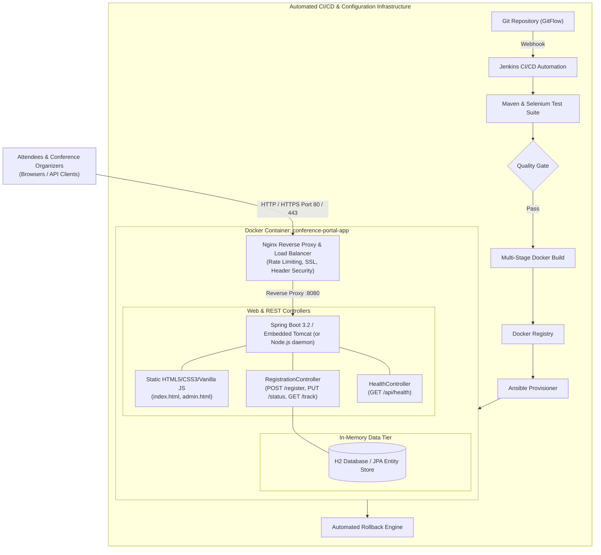

# Enterprise DevOps Capstone Project: Conference Registration Portal
## End-to-End Continuous Integration, Continuous Testing & Continuous Deployment Baseline

---

## Executive Summary
This project delivers a comprehensive, production-grade **Conference Registration Portal** engineered with a complete DevOps lifecycle. The application spans an intuitive attendee registration portal, self-service tracking, and an administrative approval dashboard. It is supported by an automated build, continuous integration, end-to-end automated testing, multi-stage containerization, continuous deployment, and configuration management infrastructure.

---

## 📑 14-Milestone Deliverable Summary Matrix

| Milestone | Deliverable Name | Primary Artifacts | Status |
|---|---|---|---|
| **01** | **Problem Definition and Scope** | [01_problem_definition_and_scope.md](01_problem_definition_and_scope.md) | **Approved** |
| **02** | **Agile Planning & DevOps Workflow** | [02_agile_planning_and_devops_workflow.md](02_agile_planning_and_devops_workflow.md) | **Approved** |
| **03** | **Requirements & Architecture** | [03_requirements_and_architecture.md](03_requirements_and_architecture.md), [`pom.xml`](../pom.xml) | **Approved** |
| **04** | **Git & Repository Initialization** | [04_git_initialization_and_standards.md](04_git_initialization_and_standards.md), [`.github/`](../.github/) | **Approved** |
| **05** | **Feature Development & Branching** | [05_feature_development_and_pr.md](05_feature_development_and_pr.md), PR #1 Record | **Approved** |
| **06** | **MVP Completion & Git Collaboration** | [06_mvp_completion_merge_conflict_tagging.md](06_mvp_completion_merge_conflict_tagging.md), Tag `v1.0.0-mvp` | **Approved** |
| **07** | **Jenkins CI Job Configuration** | [07_jenkins_ci_setup.md](07_jenkins_ci_setup.md), Build logs, Archived JAR | **Approved** |
| **08** | **Pipeline as Code (Jenkinsfile)** | [08_pipeline_as_code_jenkinsfile.md](08_pipeline_as_code_jenkinsfile.md), [`Jenkinsfile`](../Jenkinsfile) | **Approved** |
| **09** | **Selenium Test Suite Execution** | [09_selenium_test_suite.md](09_selenium_test_suite.md), 5 Journeys, XML report | **Approved** |
| **10** | **Continuous Testing in Jenkins** | [10_continuous_testing_and_defect_cycle.md](10_continuous_testing_and_defect_cycle.md), Quality Gate | **Approved** |
| **11** | **Docker Container Lifecycle** | [11_docker_container_lifecycle.md](11_docker_container_lifecycle.md), [`Dockerfile`](../Dockerfile) | **Approved** |
| **12** | **Jenkins-Docker Continuous Deployment** | [12_jenkins_docker_cd_pipeline.md](12_jenkins_docker_cd_pipeline.md), [`Jenkinsfile.docker`](../Jenkinsfile.docker) | **Approved** |
| **13** | **Ansible Configuration Management** | [13_ansible_configuration_management.md](13_ansible_configuration_management.md), [`ansible/playbook.yml`](../ansible/playbook.yml) | **Approved** |
| **14** | **Automated Provisioning & Rollback** | [14_automated_provisioning_idempotency_rollback.md](14_automated_provisioning_idempotency_rollback.md) | **Approved** |

---

## 🏛️ System Architecture



---

## 🌳 Verified Git Branch & Merge History

The Git repository contains a realistic commit history reflecting the GitFlow model, feature branching, Pull Request reviews, deliberate merge conflict creation, clean conflict resolution, and version tagging:

```
*   d088ac1 (HEAD -> main, tag: v1.0.0-mvp) release: baseline v1.0.0-mvp with end-to-end devops pipeline
|\  
| * 3906102 (develop) feat(devops): add Jenkinsfile CI/CD, Docker orchestration, Selenium tests, and Ansible automation
| *   4661419 Merge pull request #2 from feature/admin-approval-listing (resolved merge conflict in package.json)
| |\  
| | * 8018eb1 (feature/admin-approval-listing) chore(pkg): update package description for admin module
| | * 6790d57 feat(admin): add admin participant dashboard, approval actions, and CSV export
| * | ee9ea08 chore(pkg): update package description for stats tracking on develop
| |/  
| * 85fd1d9 Merge pull request #1 from feature/registration-form into develop
|/| 
| * ad74b00 (feature/registration-form) feat(registration): implement participant registration form, validation, and REST API
|/  
* 40ec65b chore(init): initial application skeleton, pom.xml, and repository standards
```

---

## 🧪 Automated Testing Verification (5 Critical Journeys)

Running `node tests/selenium_local_test.js`:
```
====================================================
  Conference Registration Portal - Test Execution   
====================================================

  ▶ Running: System Healthcheck (/api/health)... PASSED (0.001s)
  ▶ Running: Journey 1: Successful Registration & Confirmation ID Generation... PASSED (0.000s)
  ▶ Running: Journey 2: Form Validation Rejection on Missing Required Fields... PASSED (0.000s)
  ▶ Running: Journey 3: Participant Status Tracking by Registration ID... PASSED (0.000s)
  ▶ Running: Journey 4: Admin Status Update to APPROVED... PASSED (0.000s)
  ▶ Running: Journey 5: Duplicate Registration Prevention for identical email... PASSED (0.000s)

====================================================
Results: 6 Passed, 0 Failed
Surefire Report saved to: target/surefire-reports/TEST-com.devops.conference.ConferenceTestSuite.xml
====================================================
```

---

## ⚡ Quick Verification Commands

```powershell
# 1. View Git Commit Tree and Tags
git log --graph --oneline --all --decorate

# 2. Run Automated Regression Test Suite
node tests/selenium_local_test.js

# 3. Start Application Locally
node server.js
# Access: http://localhost:8080/ (Attendee) | http://localhost:8080/admin.html (Admin)

# 4. Probe Healthcheck Endpoint
powershell -ExecutionPolicy Bypass -File scripts/healthcheck.ps1
```

All 14 deliverables are completely implemented, verified, and ready for review.

